<div align="center">

<!-- Typing SVG — animação de texto dinâmica -->


<br/>

<!-- Badges de contato -->
[](https://www.linkedin.com/in/pedro-gilson-lima-brilhante-878b67417)
[](mailto:pedrog.brilhante@gmail.com)

</div>

---

<p align="center">
  <a href="#pt">🇧🇷 Português</a> &nbsp;·&nbsp; <a href="#en">🇺🇸 English</a>
</p>

<!-- ═══════════════════════════════════════════ -->
<!-- 🇧🇷 PORTUGUÊS                              -->
<!-- ═══════════════════════════════════════════ -->

<h2 id="pt">🇧🇷 &nbsp;Sobre mim</h2>

```text
  Técnico em Desenvolvimento de Sistemas
  Cursando Ciência da Computação — IFCE
  Construindo projetos reais como dev backend
  Foco atual: APIs REST com Spring Boot & .NET
  Buscando: estágio / primeira oportunidade como desenvolvedor
```

<h3>🛠️ &nbsp;Tech Stack</h3>

<table>
  <tr>
    <td align="center" width="110"><b>Linguagens</b></td>
    <td>
      <a href="https://skillicons.dev">
        
      </a>
    </td>
  </tr>
  <tr>
    <td align="center" width="110"><b>Frameworks</b></td>
    <td>
      <a href="https://skillicons.dev">
        
      </a>
    </td>
  </tr>
  <tr>
    <td align="center" width="110"><b>Banco de Dados</b></td>
    <td>
    <a href="https://skillicons.dev">
      
    </a>
    </td>
  </tr>
  <tr>
    <td align="center" width="110"><b>Ferramentas</b></td>
    <td>
      <a href="https://skillicons.dev">
        
      </a>
    </td>
  </tr>
</table>

> 💡 *Veja todos os meus repositórios [aqui](https://github.com/pedroglb-dev?tab=repositories).*

---

<!-- ═══════════════════════════════════════════ -->
<!-- 🇺🇸 ENGLISH                                 -->
<!-- ═══════════════════════════════════════════ -->

<h2 id="en">🇺🇸 &nbsp;About me</h2>

```text
  Technical degree in Systems Development
  Studying Computer Science — IFCE (Brazil)
  Building real-world projects as a backend dev
  Current focus: REST APIs with Spring Boot & .NET
  Looking for: internship / first dev role
```

<h3>🛠️ &nbsp;Tech Stack</h3>

<table>
  <tr>
    <td align="center" width="110"><b>Languages</b></td>
    <td>
      <a href="https://skillicons.dev">
        
      </a>
    </td>
  </tr>
  <tr>
    <td align="center" width="110"><b>Frameworks</b></td>
    <td>
      <a href="https://skillicons.dev">
        
      </a>
    </td>
  </tr>
  <tr>
    <td align="center" width="110"><b>Databases</b></td>
    <td>
      <a href="https://skillicons.dev">
        
      </a>
    </td>
  </tr>
  <tr>
    <td align="center" width="110"><b>Tools</b></td>
    <td>
      <a href="https://skillicons.dev">
        
      </a>
    </td>
  </tr>
</table>

> 💡 *See all my repositories [here](https://github.com/pedroglb-dev?tab=repositories).*

---

<!-- ═══════════════════════════════════════════ -->
<!-- 📊 STATS                                    -->
<!-- ═══════════════════════════════════════════ -->

<div align="center">

<h3>📊 &nbsp;GitHub Stats</h3>


&nbsp;&nbsp;


<br/><br/>


</div>

---

<div align="center">
  
</div>
